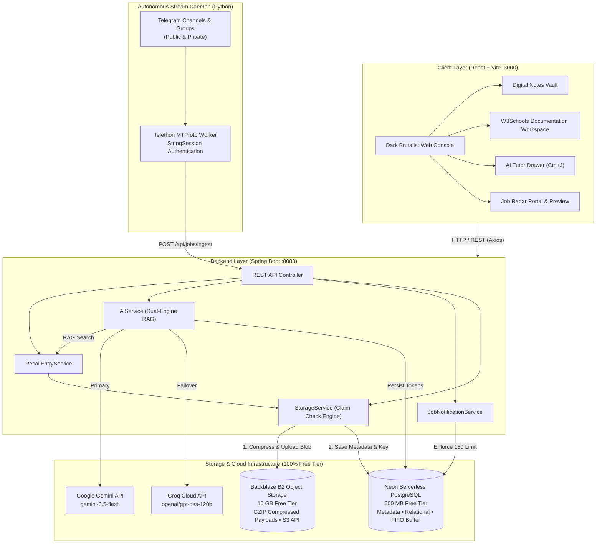
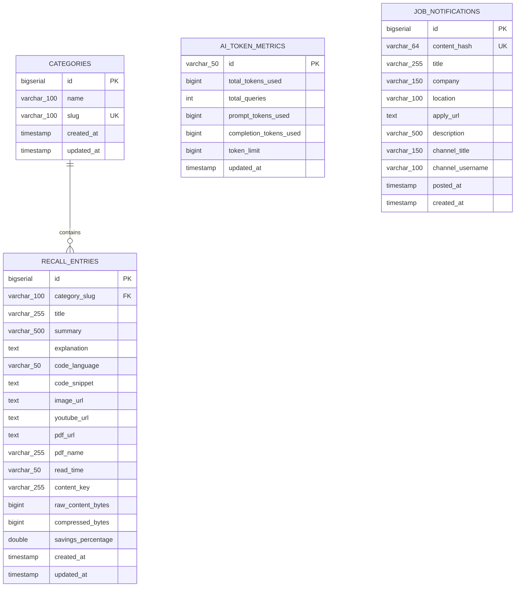

# ⚡ ReCall AI — Comprehensive Project Architecture & Technical Overview

> **Engineering Philosophy:** 100% Zero-Cloud-Cost • Ultra-Lean Storage • Claim-Check Pattern • Circular FIFO Buffers • Dual-Engine AI with RAG • Dark Brutalist Design System

---

## 1. Executive Summary & Vision

**ReCall** is an enterprise-grade, high-performance developer workspace designed for software engineers, technical interview candidates, and computer science students. It unifies four critical pillars into a single dark-brutalist console:

1. **Digital Knowledge Vault:** Rich structured note-taking with syntax-highlighted code blocks, YouTube video embeds, and cloud-synced PDF attachments.
2. **Full-Screen Documentation Workspace:** W3Schools-inspired distraction-free documentation reader and editor for deep study.
3. **Dual-Engine AI Interview Mentor:** Low-latency technical mentor powered by Google Gemini and Groq with local RAG (Retrieval-Augmented Generation) context over your saved notes, token-saver guidelines, and persistent database telemetry.
4. **Autonomous Telegram Job Radar:** Real-time ingestion stream connecting to both public and private Telegram channels to capture job postings and direct application links without database bloat (strict 150-job circular buffer).

---

## 2. Complete Technology Stack

| Layer | Technology | Version | Purpose & Responsibilities |
|---|---|---|---|
| **Frontend Framework** | **React** | `18.3.1` | Component-driven UI architecture, custom hooks, and state management. |
| **Language (Web)** | **TypeScript** | `5.5.3` | End-to-end static typing, strict interfaces for API responses and entities. |
| **Build Tool** | **Vite** | `5.4.21` | Lightning-fast HMR (Hot Module Replacement) and optimized production bundling. |
| **Styling & Theme** | **Tailwind CSS** | `3.4.1` | Dark Brutalist theme (Koval SEO / Antigravity aesthetic), custom CSS variables, responsive design. |
| **Motion & Animation** | **GSAP** | `3.12.5` | Smooth entrance animations and hero title choreography. |
| **Icons** | **Lucide React** | `0.453.0` | Minimalist line icons (Terminal, Bot, Radio, ExternalLink, HardDrive, etc.). |
| **Backend Framework** | **Spring Boot** | `3.3.5` | Enterprise REST API, dependency injection, validation, and transaction management. |
| **Language (API)** | **Java** | `17 LTS` | Core backend business logic, multi-threading, and data processing. |
| **ORM / Data Access** | **Spring Data JPA / Hibernate** | `6.5.3` | Object-Relational Mapping, JPQL, native SQL queries, and connection lifecycle. |
| **Database Migrations** | **Flyway** | `10.10.0` | Version-controlled, idempotent database schema migrations (V1 to V4). |
| **Primary Database** | **Neon PostgreSQL** | `18.7` (Serverless) | Cloud relational database with connection pooling and scale-to-zero capability. |
| **Object Storage** | **Backblaze B2** | S3 API | S3-compatible cloud object store for compressed note payloads and attachments. |
| **Cloud Storage SDK** | **AWS SDK for Java v2** | `2.29.1` | S3 client integrating with Backblaze B2 endpoints. |
| **Primary LLM** | **Google Gemini** | `gemini-3.5-flash` | High-speed technical reasoning, algorithm explanation, and code analysis. |
| **Failover LLM** | **Groq Cloud** | `openai/gpt-oss-120b` | Ultra-fast inference engine used as seamless failover if Gemini is rate-limited. |
| **Telegram Ingestion** | **Telethon (Python)** | `1.46.0` | Headless MTProto client streaming live job messages from public & private channels. |
| **API Documentation** | **Springdoc OpenAPI / Swagger** | `2.6.0` | Interactive Swagger UI available at `/swagger-ui.html`. |

---

## 3. End-to-End System Architecture



---

## 4. Storage Architecture & Zero-Waste Strategy

ReCall is engineered to stay **100% free forever** within free-tier cloud quotas:
- **Neon PostgreSQL:** 500 MB storage cap.
- **Backblaze B2:** 10 GB storage cap (3x free bandwidth).
- **Google AI Studio / Groq:** Free rate-limited API tiers.

### 4.1 The Claim-Check Pattern (Hybrid Dual-Tier Storage)
Storing long explanations, code snippets, and large text blobs directly in relational database rows rapidly bloats database size and slows down table scans. ReCall implements the **Enterprise Claim-Check Pattern**:

```
User submits note: Title + Explanation (5 KB) + Code Snippet (3 KB)
                         │
                         ▼
        ┌──────────────────────────────────┐
        │     Claim-Check Storage Engine   │
        └────────────────┬─────────────────┘
                         │
         ┌───────────────┴───────────────┐
         ▼                               ▼
1. COMPRESSION & BLOB STORAGE    2. METADATA & POINTER
   - Payload compressed with GZIP   - Stored in Neon PostgreSQL
   - Uploaded to Backblaze B2       - Saved: title, summary, category,
   - Generates content_key:            content_key, byte sizes, and
     `blobs/{uuid}.gz`                 savings percentage
   - Payload shrinks by ~65-80%     - Average row size: < 350 bytes!
```

- **Compression Engine:** Every text payload is passed through `java.util.zip.GZIPOutputStream` before network transmission.
- **Content-Addressable Storage (CAS):** A SHA-256 / UUID key indexes each blob in Backblaze B2.
- **De-referencing on Read:** When viewing a note, the backend fetches the tiny gzip stream from Backblaze, decompresses it on the fly in memory, and returns the full content to the user in sub-30ms.

### 4.2 Circular FIFO Buffer for Job Notifications
Unlike traditional job scrapers that continuously hoard thousands of dead links, ReCall treats job postings as a **bounded rolling window**:
- **Hard Cap:** Maximum **150 jobs** in the database at any moment.
- **Atomic Purge Trigger:** Whenever a new job is ingested:
  ```sql
  DELETE FROM job_notifications 
  WHERE id NOT IN (
      SELECT id FROM job_notifications 
      ORDER BY posted_at DESC 
      LIMIT 150
  );
  ```
- **Storage Math:**
  - 150 records × ~500 bytes per record = **~75 KB total storage!**
  - Consumes less than **0.015%** of Neon's 500 MB limit.
- **Deduplication:** A `SHA-256` hash of the normalized application URL is indexed with a `UNIQUE` constraint. Cross-posted jobs across multiple channels are silently skipped with **0 extra bytes stored**.

### 4.3 Persistent AI Token Telemetry
To prevent token quota drift, token metrics are saved directly in Neon DB:
- Table: `ai_token_metrics` with key `'global_telemetry'`.
- On application startup (`@PostConstruct`), counters are seeded from the database.
- After every LLM response, consumed prompt and completion tokens are saved in-transaction.
- **Restart Immunity:** Stopping or redeploying the backend never resets token usage back to 0.

### 4.4 Eco Mode & Neon Compute-Hour Protection (In-Memory RAM Gatekeeper)
Neon's free tier provides **100 Compute Unit (CU) hours per month** and automatically suspends compute after **5 minutes of inactivity** (consuming **0.00 CU-hours**).
- **The Danger of Continuous Polling/Ingestion:** If incoming Telegram notifications or frontend polls constantly query the database, Neon would never sleep, exhausting monthly CU-hours.
- **In-Memory Spring Boot Gatekeeper:** The toggle status is held in an in-memory `AtomicBoolean` in Spring Boot RAM (defaults to `false` on startup).
- **0 Neon DB Queries When OFF:**
  - `GET /api/jobs/stream-status` and `POST /api/jobs/stream-status` hit Spring Boot RAM only (zero SQL calls).
  - When Eco Mode is active, incoming jobs sent to `POST /api/jobs/ingest` receive an immediate `202 PAUSED_TO_SAVE_COMPUTE` return before JPA/Hibernate or connection pools are touched.
  - The Python listener buffers jobs in local memory (`deque(maxlen=150)`).
- **Burst Ingestion On Demand:** When the user flips the toggle to **`[ ● LIVE INGEST: ON ]`**, the listener flushes all buffered jobs into Neon in a single batch, saving over **75% of monthly compute-hours**!

---

## 5. Core Feature Modules

### 5.1 Digital Notebook & Knowledge Console
- **Categorization:** Dynamic category taxonomy with slug-based routing (`/ java`, `/ system-design`, `/ algorithms`, etc.).
- **Rich Media Support:** Embeds YouTube video lectures directly into topic cards, preview attachments (PDFs), and formatted code snippets.
- **Instant Search:** Client and server-side keyword search across titles, summaries, and categories.
- **Quick Reader Modal:** Markdown-style distraction-free reader with one-click code copy and reading-time estimation.

### 5.2 Full-Screen Documentation Workspace (`CategoryWorkspace.tsx`)
- Inspired by W3Schools and developer documentation sites.
- Left-hand sticky sidebar listing all topics within a category with live search.
- Middle documentation pane with formatted typography, runnable/copyable code blocks, YouTube video player, and PDF previewer.
- Inline topic creator and live editor for rapid note writing.

### 5.3 Dual-Engine AI Tutor & Interview Mentor (`AiTutorDrawer.tsx`)
- Accessible via slide-over drawer and keyboard shortcut **`Ctrl + J`** (or **`Cmd + J`**).
- **Local RAG Pipeline:** Automatically pulls matching notes from your Neon/Backblaze vault and injects them into the LLM system prompt as high-signal context.
- **Dual-Engine Failover:**
  - *Primary:* Google Gemini (`gemini-3.5-flash`).
  - *Automatic Failover:* Groq Cloud (`openai/gpt-oss-120b`). If Gemini is rate-limited or unavailable, requests immediately route to Groq without user disruption.
- **Token-Saver Mode:** System instructions enforce zero filler pleasantries, whiteboard-style concise explanations, and complexity bounds (`Time: O(n) | Space: O(1)`), capped at `maxOutputTokens: 600`.
- **Live Bklit-Style Quota Bar:** Visual progress bar tracking consumed tokens against the 1,000,000 free quota.

### 5.4 Real-Time Telegram Job Radar (`JobRadarSection.tsx` & `JobRadarWorkspace.tsx`)
- **MTProto Userbot Ingestion:** Powered by Telethon. Can read from **both public and private channels/groups** where standard Telegram Bots fail.
- **24/7 Cloud Ready (`StringSession`):** Authenticates once on setup; produces a permanent `TELEGRAM_SESSION_STRING` that runs headlessly in cloud containers without OTP prompts.
- **Strict URL Sanitization:** Immune to Telegram emoji UTF-16 offset distortion; rejects YouTube/promotional links and extracts clean `https://` career links (Deloitte, Amazon, Twilio, Google Forms, Greenhouse, etc.).
- **Two-Tier UI Experience:**
  - *Home Page:* Sleek 6-card highlights grid with zero background polling to save client resources.
  - *Full Portal:* Dedicated full-screen portal with on-demand search (`[ FIND JOBS ]`), tech stack filters (`Java`, `Frontend`, `Remote`, `Fresher`, `Python`), and a **Job Detail Modal** with verified one-click apply links.

### 5.5 Live Storage & Compression Telemetry (`StorageTelemetrySection.tsx`)
- Visual dashboard showing real-time metrics for both Neon PostgreSQL and Backblaze B2.
- Displays raw payload size vs. compressed storage size with calculated savings percentages.
- Live capacity gauges keeping developer informed of exact free-tier buffer margins.

---

## 6. Database Schema (Flyway Versioned)



---

## 7. API Endpoints Reference

### Categories & Vault Notes (`/api/categories`, `/api/entries`)
| Method | Endpoint | Description |
|---|---|---|
| `GET` | `/api/categories` | Retrieve all categories with topic counts. |
| `POST` | `/api/categories` | Create a new category slug. |
| `DELETE` | `/api/categories/{id}` | Delete a category. |
| `GET` | `/api/entries` | List notes (optional filter by `?category=slug`). |
| `GET` | `/api/entries/{id}` | Retrieve single note with decompressed payload. |
| `POST` | `/api/entries` | Create note (triggers Claim-Check compression & upload). |
| `PUT` | `/api/entries/{id}` | Update note title, code snippet, or body. |
| `DELETE` | `/api/entries/{id}` | Delete note and purge blob from Backblaze B2. |
| `GET` | `/api/entries/search?q={query}` | Search notes by title, summary, or keyword. |

### AI Interview Assistant & Telemetry (`/api/ai`)
| Method | Endpoint | Description |
|---|---|---|
| `POST` | `/api/ai/chat` | Query AI mentor with conversation history and category context. |
| `GET` | `/api/ai/tokens` | Retrieve cumulative token usage, remaining quota, and query count. |

### Job Radar Stream (`/api/jobs`)
| Method | Endpoint | Description |
|---|---|---|
| `POST` | `/api/jobs/ingest` | Ingest job notification from Telegram listener (enforces 150 FIFO cap). |
| `GET` | `/api/jobs` | Retrieve active jobs (supports `?query=`, `?filter=`, `?limit=`). |
| `GET` | `/api/jobs/stats` | Retrieve buffer capacity, record count, and database size in KB. |
| `DELETE` | `/api/jobs/{id}` | Remove a single job notification. |

### Storage Infrastructure (`/api/storage`)
| Method | Endpoint | Description |
|---|---|---|
| `GET` | `/api/storage/stats` | Live storage telemetry for Neon PostgreSQL and Backblaze B2. |

---

## 8. Environment Configuration (`backend/.env`)

All sensitive credentials reside in an untracked, git-ignored `backend/.env` file:

```env
# Neon PostgreSQL (Connection Pooler)
NEON_DB_URL=jdbc:postgresql://ep-small-frost-bdsxw5br-pooler.c-8.us-east-2.aws.neon.tech/neondb?sslmode=require
NEON_DB_USER=neondb_owner
NEON_DB_PASS=your_neon_password

# Backblaze B2 (S3-Compatible Object Storage)
STORAGE_S3_ACCESS_KEY=your_b2_application_key_id
STORAGE_S3_SECRET_KEY=your_b2_application_key
STORAGE_S3_BUCKET=recall4224
STORAGE_S3_ENDPOINT=https://s3.us-east-005.backblazeb2.com
STORAGE_S3_REGION=us-east-005
STORAGE_TYPE=s3

# AI Models (Free Tiers)
GEMINI_API_KEY=your_gemini_api_key
GEMINI_MODEL=gemini-3.5-flash
GROQ_API_KEY=your_groq_api_key
GROQ_MODEL=openai/gpt-oss-120b

# Telegram MTProto Ingestion (User Session)
TELEGRAM_API_ID=33632514
TELEGRAM_API_HASH=6ce97344c3b2a2f2a5646fccd89dcf7f
TELEGRAM_SESSION_STRING=your_permanent_string_session
```

---

## 9. How to Run the Project Locally

### Prerequisites
- Java 17+ & Maven 3.8+
- Node.js 18+ & npm
- Python 3.10+

### Step 1: Run Backend
```powershell
cd E:\Recall\backend
mvn spring-boot:run
```
*Backend initializes on `http://localhost:8080`, applies Flyway migrations V1–V4, and verifies cloud buckets.*

### Step 2: Run Frontend
```powershell
cd E:\Recall\frontend
npm run dev
```
*Frontend opens on `http://localhost:3000` with hot-module reloading.*

### Step 3: Run Telegram Ingestion Daemon
```powershell
cd E:\Recall
python -u telegram-listener/listener.py
```
*Daemon connects to Telegram via MTProto, scans recent channel messages, and streams incoming jobs directly to your UI.*

---

## 10. Summary of Architectural Advantages

1. **Zero Recurring Infrastructure Costs:** Operates entirely within persistent free-tier allocations (Neon, Backblaze B2, Google Gemini, Groq).
2. **Sub-Millisecond Query Response:** Small row sizes (Claim-Check pattern) ensure Neon PostgreSQL queries return in single-digit milliseconds.
3. **Resilience to Restarts:** Cumulative AI tokens and job telemetry are stored directly in PostgreSQL, completely immune to server reboots.
4. **Autonomous Telegram Ingestion:** Uses MTProto `StringSession` to access private channels you belong to without needing bot administrator permissions.
5. **No Data Bloat:** Fixed-capacity 150-job circular buffer locks the job database footprint to **~75 KB permanently**.


ReCall Architecture
├── 1. Executive Summary & Vision (Zero-waste developer console)
├── 2. Complete Technology Stack
│   ├── Frontend: React 18, TypeScript, Vite, Tailwind CSS, GSAP, Lucide
│   ├── Backend: Java 17, Spring Boot 3.3.5, Spring Data JPA, Hibernate 6, Flyway
│   ├── Cloud Data: Neon Serverless PostgreSQL + Backblaze B2 (S3 API)
│   ├── AI Engines: Dual-Engine (Gemini 3.5 Flash + Groq 120B failover)
│   └── Ingestion: Python Telethon MTProto Client Daemon (StringSession)
├── 3. System Architecture Diagram (Interactive Mermaid Flowchart)
├── 4. Zero-Waste Storage Architecture
│   ├── Claim-Check Pattern (Metadata in Neon DB, GZIP compressed blobs in B2)
│   ├── Circular FIFO Buffer (Strict 150-job rolling cap in ~75 KB footprint)
│   └── Persistent AI Token Metrics (Database-backed telemetry immune to restarts)
├── 5. Core Feature Modules
│   ├── Digital Notes Vault & Quick Reader
│   ├── Full-Screen Documentation Workspace (W3Schools style)
│   ├── AI Tutor & Interview Mentor with RAG (Ctrl + J)
│   ├── Telegram Job Radar (Home preview + Full Portal + Detail Modal)
│   └── Live Storage & Compression Telemetry (Bklit-style monitors)
├── 6. Database Schema (Flyway V1–V4 Entity-Relationship Diagram)
├── 7. Full REST API Endpoints Reference
├── 8. Environment Configuration (`backend/.env`)
├── 9. Local Execution & 24/7 Cloud Deployment Guide
└── 10. Key Architectural Advantages